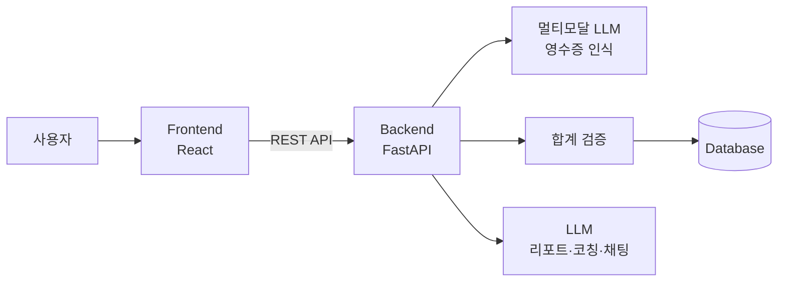

# 🧾 ReceiptCoach (영수증코치)

> 영수증 사진 한 장으로 기록하고, AI가 소비를 분석해 절약 방법까지 코칭해주는 가계부 서비스


## 📌 프로젝트 개요

### 배경
대학생과 자취생은 카드, 현금, 간편결제 등 결제 수단이 흩어져 있어 한 달 지출을 파악하기 어렵습니다. 기존 가계부 앱은 직접 입력이 번거로워 꾸준히 쓰기 힘들고, 지출 숫자만 보여줄 뿐 어떻게 줄여야 하는지는 알려주지 않습니다.

### 목적
생성형 AI(멀티모달 LLM)로 영수증 사진을 자동 인식해 품목·금액·카테고리를 기록하고, 쌓인 소비 데이터를 분석해 **개인 맞춤형 절약 코칭**을 제공합니다.

### 대상 사용자
- 용돈·아르바이트 수입으로 생활하는 대학생, 자취생
- 가계부 입력이 귀찮아 포기한 사회초년생

### 활용 상황
- 결제 직후 영수증을 찍어 3초 만에 지출 기록
- 월말에 AI 리포트로 지출이 늘어난 원인 확인
- "이번 달 배달에 얼마 썼어?"처럼 자연어로 질문
- 예산 초과가 예상되면 미리 경고 받기

## ✨ 주요 기능

| 기능 | 설명 |
|---|---|
| 📷 영수증 자동 인식 | 사진에서 가게명, 날짜, 품목, 금액을 AI가 추출 |
| ✅ 합계 검증 | 품목 합계와 총액을 비교해 인식 오류 경고 |
| 🏷️ 자동 분류 | 식비, 카페, 교통, 생활, 쇼핑 등 카테고리 자동 지정 |
| 📊 대시보드 | 월별·카테고리별 지출 차트, 예산 대비 사용률 |
| 📝 AI 월간 리포트 | 소비 패턴과 전월 대비 변화를 문장으로 설명 |
| 💡 절약 코칭 | 개인 지출 패턴에 맞춘 구체적인 절약 제안 |
| 💬 AI 채팅 | 지출 내역에 대해 자연어로 질문하고 답변 받기 |

## 🏗️ 시스템 구조



1. 사용자가 영수증 사진 업로드
2. 백엔드가 이미지를 LLM에 보내 JSON 형식으로 추출
3. 품목 합계와 총액을 비교해 검증 후 사용자 확인
4. DB에 저장
5. 리포트·코칭 요청 시 백엔드가 계산한 통계를 LLM에 전달해 설명 생성

## 🤖 AI 활용 방식

- **Structured Output:** JSON 스키마를 지정해 영수증 데이터를 일관된 형식으로 추출
- **Few-shot 분류:** 사용자가 수정한 분류 결과를 예시로 활용해 개인화
- **Function Calling:** 채팅 질문에 맞춰 DB 조회 함수를 호출한 뒤 답변
- **환각 방지:** 금액 계산은 코드가 담당하고, LLM은 해석과 문장 생성만 담당
- **개인정보 보호:** 카드번호 등 민감 정보는 추출하지 않고, LLM에는 요약 통계만 전달

## 🛠️ 기술 스택

| 구분 | 기술 |
|---|---|
| Frontend | React (Vite), Chart.js |
| Backend | Python, FastAPI |
| AI | 멀티모달 LLM API (GPT-4o mini / Gemini Flash) |
| Database | SQLite (개발), PostgreSQL (배포) |
| 배포 | Vercel, Render |

## 📅 개발 일정

> 최종 발표: **2026년 11월 17일**

| 기간 | 내용 |
|---|---|
| 10/13 ~ 10/19 | 계획서, 저장소 생성, 환경 구축, 영수증 인식 프롬프트 실험 |
| 10/20 ~ 10/26 | 백엔드 API (업로드·인식·검증·저장) |
| 10/27 ~ 11/02 | 프론트엔드 화면, 자동 분류, 대시보드 |
| 11/03 ~ 11/09 | AI 월간 리포트, 절약 코칭 (선택: AI 채팅, 예산 경고) |
| 11/10 ~ 11/16 | 배포, 테스트, 발표 준비 |
| 11/17 | 🎤 최종 발표 |

## 📁 폴더 구조 (예정)

```
receipt-coach/
├── frontend/      # React 앱
├── backend/       # FastAPI 서버
│   ├── api/
│   ├── ai/        # 프롬프트, LLM 호출
│   └── db/
├── docs/          # 설계 문서, 화면 설계
└── README.md
```

## 🚀 실행 방법

> 개발 진행 후 업데이트 예정

## 👤 개발자

- 이름: [이름]
- 소속: 동양미래대학교 [학과]
